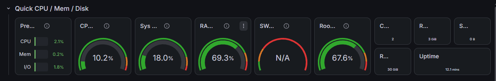
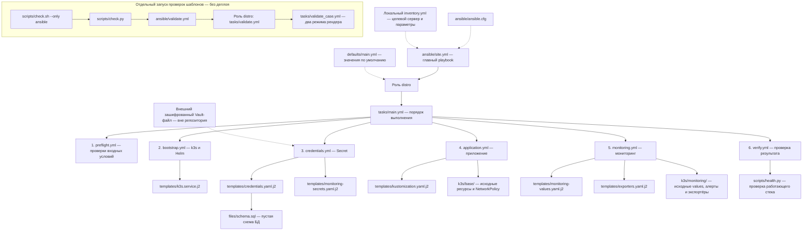

<div align= "center">
<h2> Проект Distro-space. Создан для изучения и понимания администрирования, отказоустойчивости и работы сервисов.</h2>
<p>Стек и инструменты:</p>
</div>

<div align= "center">
<a href="https://www.docker.com/"></a>
<a href="https://kubernetes.io/"></a>
<a href="https://go.dev/"></a>
<a href="https://www.mysql.com/"></a>
<a href="https://ubuntu.com/"></a>
</div>

<div align= "center">

<a href="https://developer.mozilla.org/en-US/docs/Web/HTML"></a>
<a href="https://developer.mozilla.org/en-US/docs/Web/CSS"></a>
<a href="https://developer.mozilla.org/en-US/docs/Web/JavaScript"></a>
</div>

<div align= "center">
<a href="https://www.php.net/"></a>
<a href="https://obsidian.md/"></a>
</div>

<div align= "center">
<a href="https://grafana.com/"></a>
<a href="https://prometheus.io/"></a>
<a href="https://grafana.com/oss/loki/"></a>
</div>

# Сведения о сервисе

**Содержание проекта:**
2 сайта, БД, мониторинг   
сам проект разделён на  :
[main](https://github.com/lootnick266-lgtm/Distro-space/tree/main), основная ветка — в разработке (k3s)  
[distro-space-docker](https://github.com/lootnick266-lgtm/Distro-space/tree/distro-space-docker), завершенная ветка. Рабочий docker compose с полным стеком, MVP. единственные изьяны — недоработанна вёрстка и слабый, но рабочий скрипт скачивания зависимостей для всего проекта.  

## Дополнительно  
> **но docker compose оставлен на случай локальной разработки.**  
> **Сервис развёрнут в k3s.**   

**1)  Distrospace** - сайт с тёмной темой, модальными окнами и встроенным плеером.
- Стоит на [indexbase.html](public/Distro-space/indexbase.html)  
  
**2)  Тех поддержка** - регистрация, вход в систему и чат-бот, отвечающий на ключевые слова.   
- Стоит на [index.html](public/TechSupport/index.html)
- Имеется Админ-Панель 

  

Функции подов: 

- хранилище базы данных  
- запуск сервисов  
- мониторинг  
- логирование  
- проверка доступности  
- уведомления в мессенджеры  


**Проект распространяется под лицензией MIT**
[LICENSE](LICENSE)

**выбранные направления:**
<ul>
<li>Системное администрирование</li>
<li>DevOps</li>
<li>DBA</li>
</ul>

**Сам сервис состоит из:**
<ul>
<li>Оркестрация: k3s</li>
<li>Web часть: nginx, html, css, js</li>
<li>Backend: php, go</li>
<li>Администрирование: docker, linux </li>
<li>Мониторинг: prometheus, Grafana, loki , Alertmanager</li>
</ul>

**Недостающие элементы в репозитории. Но используются в проекте:**
Примеры:  
- Nginx.conf  | [находится в /docs/examples](docs/examples/nginx.conf.example)
- .env        | [находится в /docs/examples](docs/examples/.env.example)


**Идея:**
- Создать сервис , который сможет выполнять базовые задачи и в углублённых сферах.
- получить опыт с простого интереса 

# Требования к системе

**Тестировалось на:**

- Ubuntu 26.04 live server
- 2 vCPU 4096MB 30GB SSD

Скриншот Node Exporter из Grafana с включённым сервисом  

Слева направо:  
- Pressure | CPU Busy | Sys Load | RAM Used | SWAP | Used Root FS   
- CPU Cores: 2 | RAM Total: 3GiB | SWAP total: 0B  
- Root FS total 30GiB | Uptime  

   

# Быстрый старт: 

**Запуск сервиса:**  

Зайти в директорию    
```bash
cd /var/www  
git clone https://github.com/lootnick266-lgtm/Distro-space.git
cd /var/www/Distro-space
```  


Установка зависимостей   
```bash
in progress...
```   


Запустить сервис  
```bash
sudo systemctl start k3s
```  

**Проверка контейнеров:**
```bash
kubectl get pods -A
```

**Выключение сервиса:**
```bash
sudo systemctl stop k3s
```


## **Для Grafana**

используются exporter'ы
<table border="1" cellpadding="5" style="border-collapse: collapse; text-align: left;">
  <tr style="background: darkorchid; color: white;">
    <th>Экспортер</th>
    <th>ID дашборда</th>
  </tr>
  <tr><td>Node Exporter</td><td>1860</td></tr>
  <tr><td>cAdvisor</td><td>14282</td></tr>
  <tr><td>Nginx Exporter</td><td>12708</td></tr>
  <tr><td>MySQL Exporter</td><td>7362</td></tr>
  <tr><td>Blackbox Exporter</td><td>13659</td></tr>
  <tr><td>Alertmanager</td><td>13895</td></tr>
  <tr><td>Prometheus</td><td>3662</td></tr>
  <tr><td>K3S cluster monitoring</td><td>15282</td></tr>
</table>
  
## Ресурсы приложения в k3s и их связи (ER-диаграмма)

Схема описывает ресурсы namespace `distro-space`. Мониторинг и системные компоненты здесь не показаны; сетевая архитектура будет описана отдельно.


## Топология сети между контейнерами и связь   
## Legend  
in progress....   
  


## Инструментарий    
> VM в VirtualBox  
> ssh в cmd на Windows  
> ssh remote host (Расширение в Visual Studio Code)  

заметки
>[!CAUTION]
>  pgdb:
>    image: postgres:18
>    container_name: pgsql
>    restart: always
>    ports:
>      - "5432:5432"
>    networks:
>      - localhost_default
>    environment:
>      PGSQL_ROOT_PASSWORD: ${PGSQL_ROOT_PASSWORD}
>      PGSQL_DATABASE: ${PGSQL_DATABASE}
>      PGSQL_USER: ${PGSQL_USER}
>      PGSQL_PASSWORD: ${PGSQL_PASSWORD}
>    volumes:
>      - pgdb_data:/var/lib/postgresql/data
>
>
## Алерты и уведомления в k3s

Код бота — [VKAlerts/VkAlertBot.go](VKAlerts/VkAlertBot.go)
`FIRING` — проблема, `RESOLVED` — восстановление.

```bash
(cd VKAlerts && GOPROXY=off GOSUMDB=off go test ./...)
```

В k3s применяются правила из `k3s/monitoring/distro-space-alerts.yaml`.

```bash
kubectl apply -f k3s/monitoring/distro-space-alerts.yaml
```

Маршрутизация — `k3s/monitoring/alertmanager-config.yml`.
В VK идут правила с `notify=vk` и системные `warning`/`critical`; остальные — в `null`.
Ожидание группы: 30 секунд, интервал: 5 минут, повтор: 4 часа.

## Сетевые ограничения приложения

В `distro-space` запрещены входящие и исходящие соединения, кроме явных разрешений. Новым подам без подходящих меток доступен только DNS к CoreDNS.

<table border="1" cellpadding="5" style="border-collapse: collapse; text-align: left;">
  <tr style="background: darkorchid; color: white;"><th>Источник (namespace / под)</th><th>Назначение (namespace / под)</th><th>Протокол и порт назначения</th></tr>
  <tr><td>kube-system / traefik</td><td>distro-space / nginx</td><td>TCP 80</td></tr>
  <tr><td>monitoring / nginx-exporter</td><td>distro-space / nginx</td><td>TCP 80</td></tr>
  <tr><td>monitoring / blackbox-exporter</td><td>distro-space / nginx</td><td>TCP 80</td></tr>
  <tr><td>distro-space / nginx</td><td>distro-space / php</td><td>TCP 9000</td></tr>
  <tr><td>distro-space / php</td><td>distro-space / db</td><td>TCP 3306</td></tr>
  <tr><td>monitoring / mysql-exporter</td><td>distro-space / db</td><td>TCP 3306</td></tr>
  <tr><td>monitoring / blackbox-exporter</td><td>distro-space / db</td><td>TCP 3306</td></tr>
  <tr><td>monitoring / Alertmanager</td><td>distro-space / vkbot</td><td>TCP 8080</td></tr>
  <tr><td>distro-space / все поды</td><td>kube-system / CoreDNS</td><td>UDP/TCP 53</td></tr>
  <tr><td>distro-space / vkbot</td><td>IPv4-адреса вне исключённых диапазонов</td><td>TCP 443</td></tr>
</table>

Экспортёры, Blackbox и Alertmanager выбираются по меткам в namespace `monitoring`. Для подов приложения разрешён DNS к CoreDNS из `kube-system` по UDP/TCP 53.

HTTPS бота не ограничен доменом VK: обычная NetworkPolicy не фильтрует по DNS-именам. Частные, локальные и link-local диапазоны исключены из этого разрешения. Отдельных разрешений IPv6 нет.

Файлы `k3s/base/networkpolicy-allow.yaml` и `k3s/base/networkpolicy-default-deny.yaml` включены в Kustomization. При отдельном применении сначала загрузите разрешения:

```bash
kubectl apply -f k3s/base/networkpolicy-allow.yaml
kubectl apply -f k3s/base/networkpolicy-default-deny.yaml
```

Аварийный откат только этих ограничений:

```bash
kubectl delete --ignore-not-found=true -f k3s/base/networkpolicy-default-deny.yaml -f k3s/base/networkpolicy-allow.yaml
```

Следующее применение `k3s/base` восстановит политики.

Namespace `monitoring` и `kube-system` не изолированы. Публикация Grafana не изменена. NetworkPolicy не заменяют firewall ноды и защиту NodePort; трафик ноды имеет исключения на уровне Kubernetes.

SMTP-доступ PHP не разрешён: в контейнере нет `sendmail`/`msmtp`. При настройке почты потребуется разрешение к выбранному SMTP-серверу.

## Локальные проверки и CI

Из корня репозитория:

```bash
bash scripts/check.sh
bash scripts/check.sh --only go
```

Доступные группы: `checker`, `secrets`, `yaml`, `php`, `go`, `monitoring`. Пропущенных по отсутствию инструментов проверок нет: ошибка зависимости завершает запуск с ненулевым кодом.

Нужны Git, Bash, Python 3 с PyYAML, Go 1.26, kubectl 1.31.5 и Docker. Локально используются уже загруженные образы `distro-php:1.1`, `quay.io/prometheus/prometheus:v3.15.1-distroless` и `quay.io/prometheus/alertmanager:v0.34.1`.

Образы можно переопределить переменными `PHP_CHECK_IMAGE`, `PROMETHEUS_CHECK_IMAGE`, `ALERTMANAGER_CHECK_IMAGE`. Скрипт не скачивает образы; контейнеры запускаются без сети. Go использует локальный кеш модулей. На чистой машине зависимости нужно подготовить заранее: `python3 -m pip install -r scripts/requirements-checks.txt` и `(cd VKAlerts && go mod download)`.

Проверяются синтаксис PHP без исполнения кода, существующие Go-тесты и `go vet`, уникальность ключей YAML, структура ресурсов и сборка Kustomize, правила через `promtool`, конфигурация через `amtool`. Поиск секретов ограничен защитой путей Git и узнаваемыми шаблонами токенов/приватных ключей; значения в отчёт не выводятся. `.env`, `install.sh` и локальные файлы секретов не читаются.

Это не полная проверка схем Kubernetes/CRD, не проверка сетевой изоляции и не функциональные тесты PHP с БД. Рабочая БД, токен VK и доступ к живому кластеру для запуска не нужны.

Workflow `.github/workflows/checks.yml` запускает ту же команду при push, pull request и вручную. В GitHub он предварительно загружает инструменты, Go-модули и образы; затем сами проверки работают без сетевых запросов к приложению.

Старый `.github/workflows/deploy.yml` оставлен только для ручного запуска. Автоматический Compose-деплой при push отключён. Новый workflow не публикует образы и не разворачивает сервисы.

## Проверка работающего k3s

Запускается отдельно на VM/ноде с доступом к ClusterIP и настроенным kubectl:

```bash
bash scripts/health.sh
```

Нужны только Python 3 и kubectl. Адрес сайта и HTTP Host определяются из Ingress.

Проверяются Ready и отсутствие давления на ноды, готовность подов и обновлённых реплик в `distro-space`, `monitoring`, `kube-system`, наличие nginx/PHP/MySQL/VK-бота. Нулевое число реплик не считается успехом.

HTTP-проверки: главная страница и TechSupport возвращают HTML, PHP сообщает об анонимной сессии, скачивание бэкапа без входа запрещено (`403`). Проверяется готовность Prometheus и Alertmanager, состояние БД Grafana и HTTP-обработчик бота (`405` на GET без отправки сообщения).

У Prometheus проверяются свежие успешные scrape (не старше 180 секунд), значения `mysql_up`, `nginx_up`, `probe_success`, наличие обеих HTTP-проб и TCP-пробы MySQL. Все пять правил приложения должны быть загружены, исправно вычисляться и оставаться inactive. Системный Watchdog сам по себе проверку не проваливает.

Каждая проверка выводит PASS/FAIL; при ошибках код завершения — 1. Содержимое HTTP-ответов, cookies и секреты не печатаются. Скрипт не разворачивает ресурсы, не перезапускает поды и не записывает данные в БД.

Это smoke-проверка доступности, а не полный пользовательский сценарий: вход и операции записи, браузерный интерфейс, доставка в VK и фактическая блокировка всех запрещённых сетевых связей здесь не тестируются. Готовность бота не означает доступность API VK.

`scripts/test_health.py` проверяет логику health-скрипта на искусственных данных. Эти тесты включены в обычный `bash scripts/check.sh` и workflow Checks, без доступа к VM. Сам `health.sh` в GitHub автоматически не запускается; его можно будет добавить в этап после деплоя.

## Security-тесты NetworkPolicy

На VM с k3s из корня репозитория:

```bash
python3 -B scripts/security.py
```

Нужны Python 3 с PyYAML, kubectl с правами создания временных namespace, подов и NetworkPolicy. Образ `distro-nginx:1.9` должен быть импортирован на ноды заранее. Скрипт не скачивает образы; другой локальный образ с nginx, sh, nc и nslookup можно передать через `--image`.
Тест создаёт три уникальных namespace `netpol-test-<id>-app`, `netpol-test-<id>-monitoring`, `netpol-test-<id>-ingress` и 11 небольших подов-слушателей. Рабочие тома, данные БД и секреты не подключаются; вместо сервисов запускаются TCP-слушатели.
Тест создаёт три уникальных namespace `netpol-test-<id>-app`, `netpol-test-<id>-monitoring`, `netpol-test-<id>-ingress` и 11 небольших подов-слушателей. Код приложения, данные БД и секреты в них не копируются.

Из двух файлов NetworkPolicy в `k3s/base` создаются копии: namespace приложения и разрешённых источников заменяются тестовыми. Исключение — DNS к настоящему CoreDNS. Рабочие политики и сервисы не меняются.

Сначала все 20 проверяемых TCP-связей должны работать без политик. После их установки проверяются 8 разрешённых и 12 запрещённых связей; каждый запрет подтверждается двумя новыми соединениями. Ошибки kubectl/exec не считаются доказательством блокировки.

Проверяются связи Traefik/nginx/PHP/MySQL, экспортёров/Blackbox, Alertmanager/бота, запрет лишних портов, исходящих соединений БД, доступа постороннего пода и доступа с подходящими метками из неправильного namespace. DNS проверяется из всех пяти подов приложения.

Проверки выполняются по IP тестовых подов. Они не подтверждают доступность VK/внешнего HTTPS, защиту NodePort/hostNetwork, работу IPv6, фильтрацию UDP кроме DNS и изоляцию рабочих namespace мониторинга/системы.

Ресурсы удаляются в finally и при обычном прерывании. Перед удалением namespace проверяются его UID и метка текущего запуска. При SIGKILL или потере питания автоматическая очистка не гарантирована; оставшиеся тестовые namespace можно найти так:

```bash
kubectl get namespaces -l security.distro-space/test-suite=networkpolicy
```

При неудачной очистке скрипт выводит конкретные имена namespace. Проверяйте их перед ручным удалением.

Логика теста проверяется в `scripts/test_security.py`; эти автономные тесты уже входят в Checks. Сам интеграционный security-тест запускается отдельно и требует живого кластера.

## Ansible: подготовка нового сервера

Первая версия рассчитана на одну выделенную Ubuntu 22.04+ amd64-ноду: минимум 4 ГиБ RAM без swap, практически лучше 6 ГиБ RAM и 40 ГБ диска. Текущая VM защищена от запуска; принятие чужого k3s под управление запрещено.

Playbook находится в `ansible/site.yml`, задачи одной роли `distro` разделены на preflight, bootstrap, credentials, application, monitoring и verify. Дополнительные Galaxy-коллекции не нужны: используется ansible-core 2.20.1.

Образы загружаются из registry. Для nginx и PHP нужно предварительно опубликовать подготовленные образы и указать их полные версионные ссылки в inventory. Локальные tar-архивы не используются. Пароли, `.env`, локальный `config.php`, `install.sh` и рабочие дампы не копируются с управляющей VM.

Секреты передаются отдельным зашифрованным Vault-файлом вне репозитория. Пример с пустыми значениями — `ansible/vault.example.yml`; имена переменных не являются готовыми паролями. Для трёх MySQL-паролей нужны разные случайные строки из 24–128 символов A–Z, a–z, 0–9, дефисов и подчёркиваний.

Схема `ansible/roles/distro/files/schema.sql` содержит только пять пустых таблиц. Пользователи приложения, FAQ и обращения не импортируются. MySQL выполняет init только на новом томе; повторный запуск не очищает БД. Изменение исходных паролей/имени БД при повторном запуске блокируется, а не выполняет неявную ротацию.

По умолчанию VK отключён (`distro_vk_enabled: false`), маршрут Alertmanager направлен в null. При включении нужны опубликованный образ бота и новый токен через Vault. Telegram пока не реализован.

Хранилище Grafana/Prometheus/Alertmanager по умолчанию временное, как согласовано. `distro_monitoring_persistence: true` включает тома 1/5/1 GiB соответственно. Том MySQL постоянный в обоих режимах. Grafana для нового окружения имеет ClusterIP; публикация текущей Grafana не изменялась.

Предварительная подготовка inventory (без запуска на сервере):

```bash
cd ansible
cp inventory.example.yml inventory.yml
```

В `inventory.yml` замените тестовый адрес 192.0.2.10, SSH-пользователя, hostname сайта и ссылки на опубликованные образы. Inventory игнорируется Git. Для приватного registry включите `distro_registry_auth_enabled` и передайте его учётные данные через Vault.

Проверки без подключения к целевому серверу:

```bash
cd /var/www/localhost
bash scripts/check.sh --only ansible
```

Они проверяют синтаксис и рендер двух режимов с искусственными секретами: VK/registry/persistence выключены и включены. Проверяются Kustomize, сохранение политик, отсутствие seed-данных и отсутствие мёртвого VK-маршрута. Это ещё не проверка установки с нуля.

После подготовки НОВОЙ тестовой VM и внешнего Vault-файла запуск будет выглядеть так:

```bash
cd ansible
ansible-playbook -i inventory.yml site.yml -e @/absolute/path/deploy.vault.yml --ask-vault-pass --ask-become-pass
```

При реальном запуске серверу нужен Интернет: APT, GitHub Releases для k3s, get.helm.sh, официальный Helm-репозиторий и registry образов. Бинарные файлы k3s/Helm сверяются с опубликованными SHA-256. При подготовке playbook эти скачивания не выполнялись.

После развёртывания автоматически выполняется health-проверка; при отключённом VK используется явный `--skip-vkbot`. SSH, firewall, DNS провайдера и публичный TLS этот playbook пока не настраивает. Terraform и CI-деплой будут отдельным этапом после проверки установки и повторного запуска на чистой VM.

## Иерархия Ansible (Mermaid)

Главная точка запуска — `ansible/site.yml`. Сплошные стрелки показывают вызов дочерних задач или использование файлов, пунктирные — входные настройки. Пути `tasks/`, `templates/`, `defaults/` и `files/` относятся к `ansible/roles/distro/`. Это схема файлов и управления задачами, без сетевой архитектуры.



Дочерние задачи развёртывания перечислены в порядке запуска. В режиме `--check` выполняется только preflight; отдельный `validate.yml` проверяет шаблоны локально и не запускает основной сценарий установки.
