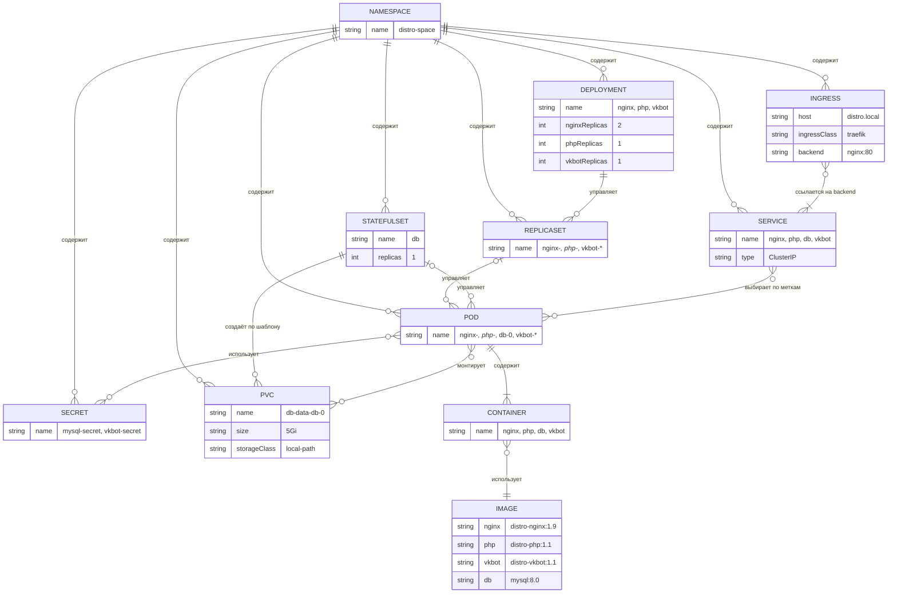

<div align= "center">
<h2> Проект Distro-space. Создан для изучения и понимания администрирования, отказоустойчивости и работы сервисов.</h2>
<p>Стек и инструменты:</p>
</div>

<div align= "center">
<a href="https://www.docker.com/"></a>
<a href="https://kubernetes.io/"></a>
<a href="https://go.dev/"></a>
<a href="https://www.mysql.com/"></a>
<a href="https://ubuntu.com/"></a>
</div>

<div align= "center">

<a href="https://developer.mozilla.org/en-US/docs/Web/HTML"></a>
<a href="https://developer.mozilla.org/en-US/docs/Web/CSS"></a>
<a href="https://developer.mozilla.org/en-US/docs/Web/JavaScript"></a>
</div>

<div align= "center">
<a href="https://www.php.net/"></a>
<a href="https://obsidian.md/"></a>
</div>

<div align= "center">
<a href="https://grafana.com/"></a>
<a href="https://prometheus.io/"></a>
<a href="https://grafana.com/oss/loki/"></a>
</div>

# Сведения о сервисе

**Содержание проекта:**
2 сайта, БД, мониторинг   
сам проект разделён на  :
[main](https://github.com/lootnick266-lgtm/Distro-space/tree/main), основная ветка — в разработке (k3s)  
[distro-space-docker](https://github.com/lootnick266-lgtm/Distro-space/tree/distro-space-docker), завершенная ветка. Рабочий docker compose с полным стеком, MVP. единственные изьяны — недоработанна вёрстка и слабый, но рабочий скрипт скачивания зависимостей для всего проекта.  

## Дополнительно  
> **но docker compose оставлен на случай локальной разработки.**  
> **Сервис развёрнут в k3s.**   

**1)  Distrospace** - сайт с тёмной темой, модальными окнами и встроенным плеером.
- Стоит на [indexbase.html](public/Distro-space/indexbase.html)  
  
**2)  Тех поддержка** - регистрация, вход в систему и чат-бот, отвечающий на ключевые слова.   
- Стоит на [index.html](public/TechSupport/index.html)
- Имеется Админ-Панель 

  

Функции подов: 

- хранилище базы данных  
- запуск сервисов  
- мониторинг  
- логирование  
- проверка доступности  
- уведомления в мессенджеры  


**Проект распространяется под лицензией MIT**
[LICENSE](LICENSE)

**выбранные направления:**
<ul>
<li>Системное администрирование</li>
<li>DevOps</li>
<li>DBA</li>
</ul>

**Сам сервис состоит из:**
<ul>
<li>Оркестрация: k3s</li>
<li>Web часть: nginx, html, css, js</li>
<li>Backend: php, go</li>
<li>Администрирование: docker, linux </li>
<li>Мониторинг: prometheus, Grafana, loki , Alertmanager</li>
</ul>

**Недостающие элементы в репозитории. Но используются в проекте:**
Примеры:  
- Nginx.conf  | [находится в /docs/examples](docs/examples/nginx.conf.example)
- .env        | [находится в /docs/examples](docs/examples/.env.example)


**Идея:**
- Создать сервис , который сможет выполнять базовые задачи и в углублённых сферах.
- получить опыт с простого интереса 

# Требования к системе

**Тестировалось на:**

- Ubuntu 26.04 live server
- 2 vCPU 4096MB 30GB SSD

Скриншот Node Exporter из Grafana с включённым сервисом  

Слева направо:  
- Pressure | CPU Busy | Sys Load | RAM Used | SWAP | Used Root FS   
- CPU Cores: 2 | RAM Total: 3GiB | SWAP total: 0B  
- Root FS total 30GiB | Uptime  

   

# Быстрый старт: 

**Запуск сервиса:**  

Зайти в директорию    
```bash
cd /var/www  
git clone https://github.com/lootnick266-lgtm/Distro-space.git
cd /var/www/Distro-space
```  


Установка зависимостей   
```bash
in progress...
```   


Запустить сервис  
```bash
sudo systemctl start k3s
```  

**Проверка контейнеров:**
```bash
kubectl get pods -A
```

**Выключение сервиса:**
```bash
sudo systemctl stop k3s
```


## **Для Grafana**

используются exporter'ы
<table border="1" cellpadding="5" style="border-collapse: collapse; text-align: left;">
  <tr style="background: darkorchid; color: white;">
    <th>Экспортер</th>
    <th>ID дашборда</th>
  </tr>
  <tr><td>Node Exporter</td><td>1860</td></tr>
  <tr><td>cAdvisor</td><td>14282</td></tr>
  <tr><td>Nginx Exporter</td><td>12708</td></tr>
  <tr><td>MySQL Exporter</td><td>7362</td></tr>
  <tr><td>Blackbox Exporter</td><td>13659</td></tr>
  <tr><td>Alertmanager</td><td>13895</td></tr>
  <tr><td>Prometheus</td><td>3662</td></tr>
  <tr><td>K3S cluster monitoring</td><td>15282</td></tr>
</table>
  
## Ресурсы приложения в k3s и их связи (ER-диаграмма)

Схема описывает ресурсы namespace `distro-space`. Мониторинг и системные компоненты здесь не показаны; сетевая архитектура будет описана отдельно.





## Топология сети между контейнерами и связь   
## Legend  
in progress....   
  


## Инструментарий    
> VM в VirtualBox  
> ssh в cmd на Windows  
> ssh remote host (Расширение в Visual Studio Code)  

заметки
>[!CAUTION]
>  pgdb:
>    image: postgres:18
>    container_name: pgsql
>    restart: always
>    ports:
>      - "5432:5432"
>    networks:
>      - localhost_default
>    environment:
>      PGSQL_ROOT_PASSWORD: ${PGSQL_ROOT_PASSWORD}
>      PGSQL_DATABASE: ${PGSQL_DATABASE}
>      PGSQL_USER: ${PGSQL_USER}
>      PGSQL_PASSWORD: ${PGSQL_PASSWORD}
>    volumes:
>      - pgdb_data:/var/lib/postgresql/data
>
>
## Алерты и уведомления в k3s

Код бота — [VKAlerts/VkAlertBot.go](VKAlerts/VkAlertBot.go)
`FIRING` — проблема, `RESOLVED` — восстановление.

```bash
(cd VKAlerts && GOPROXY=off GOSUMDB=off go test ./...)
```

В k3s применяются правила из `k3s/monitoring/distro-space-alerts.yaml`.

```bash
kubectl apply -f k3s/monitoring/distro-space-alerts.yaml
```

Маршрутизация — `k3s/monitoring/alertmanager-config.yml`.
В VK идут правила с `notify=vk` и системные `warning`/`critical`; остальные — в `null`.
Ожидание группы: 30 секунд, интервал: 5 минут, повтор: 4 часа.


